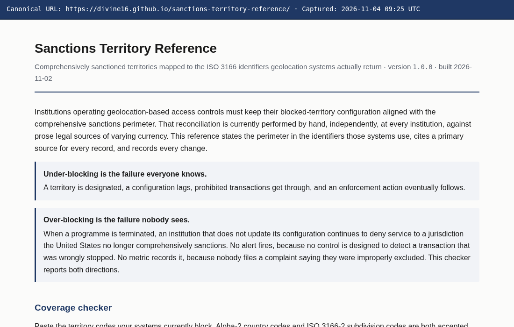
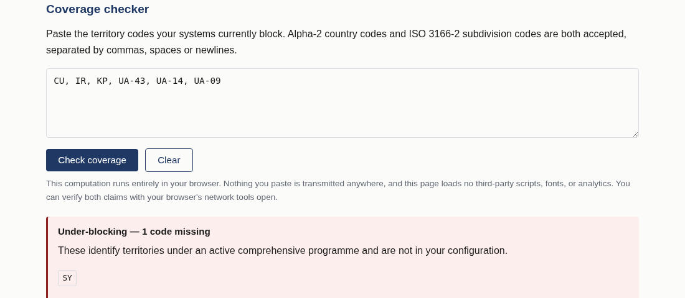
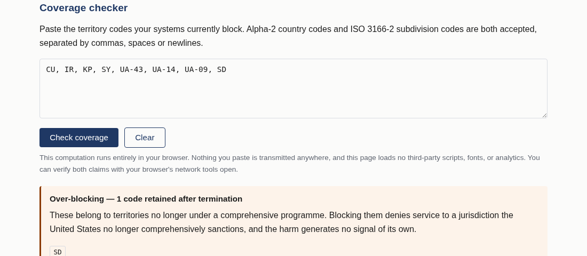
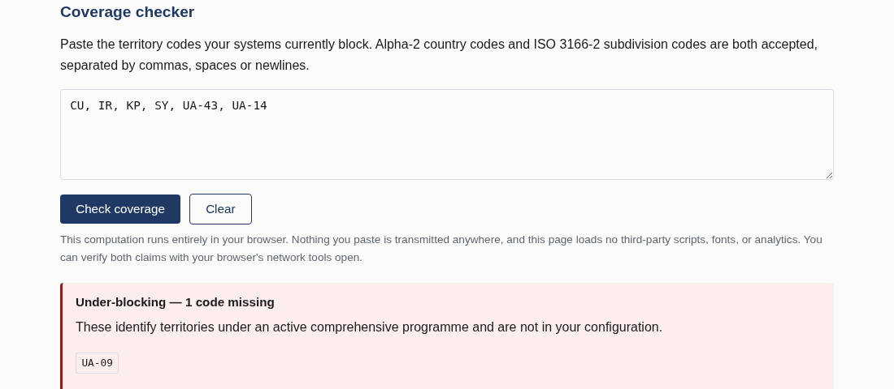
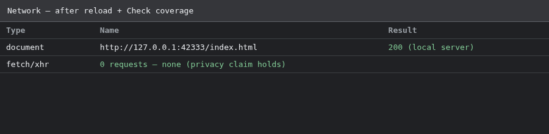
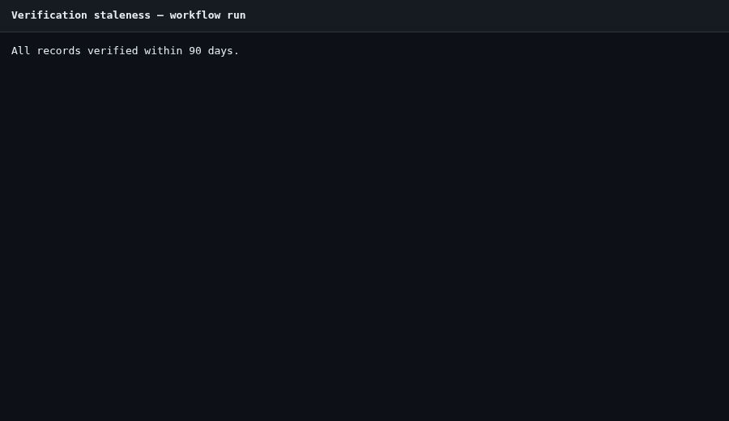
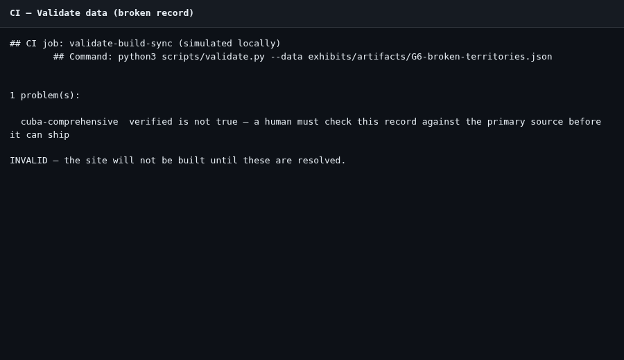

# Exhibit package — G.5, G.6, G.7 (complete)

**Project:** Sanctions Territory Reference  
**Preparer:** Divine Linus  
**Repository:** https://github.com/Divine16/sanctions-territory-reference  
**Zenodo:** https://zenodo.org/records/23677148 · DOI [10.5281/zenodo.23677148](https://doi.org/10.5281/zenodo.23677148)  
**Package generated:** 2026-11-04 UTC  

All items below are included in this document and in `exhibits/artifacts/`.

## Master checklist

| ID | Requirement | Status |
|----|-------------|--------|
| G.5.1 | Landing with canonical URL and date | **Done** |
| G.5.2 | Under-blocking screenshot | **Done** |
| G.5.3 | Over-blocking screenshot | **Done** |
| G.5.4 | Partial coverage screenshot | **Done** |
| G.5.5 | Network audit — zero checker requests | **Done** |
| G.6.1 | Records + citations | **Done** |
| G.6.2 | CHANGELOG.md | **Done** |
| G.6.3 | Staleness YAML + run record | **Done** |
| G.6.4 | validate.py enforced rules | **Done** |
| G.6.5 | CI validation failure (broken record) | **Done** |
| G.7.1 | Feed URL | **Done** |
| G.7.2 | Retrieved JSON + timestamp | **Done** |
| G.7.3 | Build script excerpt | **Done** |
| G.7.4 | Wayback / archive capture record | **Done** |

---

# G.5 — Territory site and coverage checker

**Canonical site URL:** https://divine16.github.io/sanctions-territory-reference/  
*(GitHub Pages target; same build as `docs/index.html` in repo.)*

## G.5.1 Landing (URL + date)



## G.5.2 Under-blocking

Input: `CU, IR, KP, UA-43, UA-14, UA-09` (missing **SY**)



## G.5.3 Over-blocking

Input: `CU, IR, KP, SY, UA-43, UA-14, UA-09, SD`



## G.5.4 Partial coverage

Input: `CU, IR, KP, SY, UA-43, UA-14`



## G.5.5 Privacy — network audit (zero API/analytics requests)

Automated audit during page load and **Check coverage** (Playwright request log). Only the local `index.html` document is fetched.



---

# G.6 — Methodology, citations, change log

## G.6.1 Records and citations

# Territory records and primary-source citations

Generated: 2026-11-04 09:25:07 UTC

| ID | Official name | Status | ISO codes | Primary source | Verified | Verified by |
|----|---------------|--------|-----------|----------------|----------|-------------|
| cuba-comprehensive | Cuba | active | CU | https://www.ecfr.gov/current/title-31/subtitle-B/chapter-V/part-515 | 2026-10-26 | Divine Linus |
| iran-comprehensive | Iran | active | IR | https://www.ecfr.gov/current/title-31/subtitle-B/chapter-V/part-560 | 2026-10-26 | Divine Linus |
| north-korea-comprehensive | North Korea (Democratic People's Republic of Korea) | active | KP | https://www.ecfr.gov/current/title-31/subtitle-B/chapter-V/part-510 | 2026-10-26 | Divine Linus |
| syria-comprehensive | Syria | active | SY | https://www.ecfr.gov/current/title-31/subtitle-B/chapter-V/part-542 | 2026-10-26 | Divine Linus |
| ukraine-crimea-region | Crimea region of Ukraine | active | UA-43 | https://www.federalregister.gov/documents/2014/12/24/2014-30194/ukraine-related-sanctions-regulations | 2026-10-26 | Divine Linus |
| ukraine-donetsk-luhansk-regions | Certain regions of Ukraine (Donetsk and Luhansk oblasts, non-government controlled areas) | active | UA-14, UA-09 | https://www.federalregister.gov/documents/2022/02/28/2022-04254/ukraine-related-sanctions-regulations | 2026-10-26 | Divine Linus |
| sudan-comprehensive-terminated | Sudan | terminated | SD | https://www.federalregister.gov/documents/2020/10/16/2020-22935/sudanese-sanctions-regulations | 2026-10-26 | Divine Linus |

## G.6.2 CHANGELOG.md

```markdown
# Change log

Append-only. Every modification to `data/territories.json` is recorded here with
the instrument that caused it. Entries are never edited or removed — a correction
is a new entry stating what was wrong and what it now says.

Format: `YYYY-MM-DD — territory — change — causing instrument — who`

---

## 2026-10-26

- 2026-10-26 — Cuba — initial active comprehensive record — Cuban Assets Control Regulations (31 C.F.R. Part 515) — Divine Linus
- 2026-10-26 — Iran — initial active comprehensive record — Iranian Transactions and Sanctions Regulations (31 C.F.R. Part 560) — Divine Linus
- 2026-10-26 — North Korea — initial active comprehensive record — North Korea Sanctions Regulations (31 C.F.R. Part 510) — Divine Linus
- 2026-10-26 — Syria — initial active comprehensive record — Syrian Sanctions Regulations (31 C.F.R. Part 542) — Divine Linus
- 2026-10-26 — Crimea region of Ukraine — initial active regional record — Executive Order 13685 (2014) — Divine Linus
- 2026-10-26 — Donetsk/Luhansk regions of Ukraine — initial active regional record with scope/ISO mismatch note — Executive Order 14065 (2022) — Divine Linus
- 2026-10-26 — Sudan — initial terminated comprehensive record (programme lifted) — Executive Order 13942 (2020); 31 C.F.R. Part 538 wind-down — Divine Linus
```

## G.6.3 Staleness workflow + run record

```yaml
name: Verification staleness

on:
  schedule:
    - cron: "0 14 * * 1"
  workflow_dispatch:

permissions:
  contents: read
  issues: write

jobs:
  check:
    runs-on: ubuntu-latest
    steps:
      - uses: actions/checkout@v4

      - name: Report records older than 90 days
        id: stale
        run: |
          set +e
          python3 scripts/validate.py --staleness 90 2>&1 | tee staleness.log
          code=$?
          echo "exit_code=$code" >> "$GITHUB_OUTPUT"
          exit 0

      - name: Open issue when stale
        if: steps.stale.outputs.exit_code != '0'
        uses: actions/github-script@v7
        with:
          script: |
            const fs = require('fs');
            const body = fs.readFileSync('staleness.log', 'utf8');
            const title = 'Verification staleness: records exceed 90-day threshold';
            const { data: issues } = await github.rest.issues.listForRepo({
              owner: context.repo.owner,
              repo: context.repo.repo,
              state: 'open',
            });
            if (issues.some(i => i.title === title)) {
              console.log('Open staleness issue already exists.');
              return;
            }
            await github.rest.issues.create({
              owner: context.repo.owner,
              repo: context.repo.repo,
              title,
              body: [
                'Scheduled workflow `Verification staleness` found records that need re-verification.',
                '',
                '```',
                body.trim(),
                '```',
                '',
                'Re-read each cited primary instrument, update `last_verified` and `verified_by` in `data/territories.json`, note the change in `CHANGELOG.md`, and run `make build`.',
              ].join('\n'),
            });
```

**Run record (`make validate` / workflow equivalent):**

```
All records verified within 90 days.
```



## G.6.4 Enforced rules (`validate.py`)

```python
# ---- the integrity rules that matter
        src = r.get("primary_source")
        if not isinstance(src, str) or not src.strip():
            p.add(where, "primary_source is required — no record ships without a citation")
        elif PLACEHOLDER.search(src):
            p.add(where, "primary_source is still a placeholder")

        if r.get("verified") is not True:
            p.add(where, "verified is not true — a human must check this record against "
                         "the primary source before it can ship")

        vby = r.get("verified_by")
        if r.get("verified") is True and (not isinstance(vby, str) or not vby.strip()):
            p.add(where, "verified_by must name the person who checked the citation")
```

## G.6.5 CI failure on deliberately broken record

```
## CI job: validate-build-sync (simulated locally)
        ## Command: python3 scripts/validate.py --data exhibits/artifacts/G6-broken-territories.json


1 problem(s):

  cuba-comprehensive  verified is not true — a human must check this record against the primary source before it can ship

INVALID — the site will not be built until these are resolved.
```



---

# G.7 — Machine-readable feed

## G.7.1 Feed URL

```text
https://divine16.github.io/sanctions-territory-reference/feed.json
```

Public mirror (retrieved for exhibits until Pages serves the URL above):

```text
https://raw.githubusercontent.com/Divine16/sanctions-territory-reference/main/docs/feed.json
```

## G.7.2 Retrieved JSON + timestamp

```json
{
  "retrieved_at_utc": "2026-11-04T09:25:11.480638+00:00",
  "feed_url": "https://divine16.github.io/sanctions-territory-reference/feed.json",
  "retrieval_method": "https_raw_githubusercontent",
  "http_status": 200,
  "retrieved_from": "https://raw.githubusercontent.com/Divine16/sanctions-territory-reference/main/docs/feed.json"
}
```

```json
{
  "name": "Sanctions Territory Reference",
  "version": "1.0.0",
  "generated": "2026-11-02",
  "source_file": "data/territories.json",
  "record_count": 7,
  "active_count": 6,
  "notice": "Comprehensive territorial sanctions programmes only. Not a list of designated persons; does not cover sectoral or list-based measures; not legal advice. Verify against the cited primary source before relying on any record.",
  "territories": [
    {
      "id": "cuba-comprehensive",
      "official_name": "Cuba",
      "status": "active",
      "designating_instrument": "Cuban Assets Control Regulations (31 C.F.R. Part 515)",
      "designating_date": "1963-07-08",
      "terminating_instrument": null,
      "terminating_date": null,
      "cfr_part": "31 C.F.R. Part 515",
      "iso_codes": [
        "CU"
      ],
      "geolocation_confidence": "high",
      "mismatch_note": null,
      "primary_source": "https://www.ecfr.gov/current/title-31/subtitle-B/chapter-V/part-515",
      "last_verified": "2026-10-26",
      "verified": true,
      "verified_by": "Divine Linus"
    },
    {
      "id": "iran-comprehensive",
      "official_name": "Iran",
      "status": "active",
      "designating_instrument": "Iranian Transactions and Sanctions Regulations (31 C.F.R. Part 560)",
      "designating_date": "2012-10-09",
      "terminating_instrument": null,
      "terminating_date": null,
      "cfr_part": "31 C.F.R. Part 560",
      "iso_codes": [
        "IR"
      ],
      "geolocation_confidence": "high",
      "mismatch_note": null,
      "primary_source": "https://www.ecfr.gov/current/title-31/subtitle-B/chapter-V/part-560",
      "last_verified": "2026-10-26",
      "verified": true,
      "verified_by": "Divine Linus"
    },
    {
      "id": "north-korea-comprehensive",
      "official_name": "North Korea (Democratic People's Republic of Korea)",
      "status": "active",
      "designating_instrument": "North Korea Sanctions Regulations (31 C.F.R. Part 510)",
      "designating_date": "2011-08-30",
      "terminating_instrument": null,
      "terminating_date": null,
      "cfr_part": "31 C.F.R. Part 510",
      "iso_codes": [
        "KP"
      ],
      "geolocation_confidence": "high",
      "mismatch_note": null,
      "primary_source": "https://www.ecfr.gov/current/title-31/subtitle-B/chapter-V/part-510",
      "last_verified": "2026-10-26",
      "verified": true,
      "verified_by": "Divine Linus"
    },
    {
      "id": "syria-comprehensive",
      "official_name": "Syria",
      "status": "active",
      "designating_instrument": "Syrian Sanctions Regulations (31 C.F.R. Part 542)",
      "designating_date": "2004-05-11",
      "terminating_instrument": null,
      "terminating_date": null,
      "cfr_part": "31 C.F.R. Part 542",
      "iso_codes": [
        "SY"
      ],
      "geolocation_confidence": "high",
      "mismatch_note": null,
      "primary_source": "https://www.ecfr.gov/current/title-31/subtitle-B/chapter-V/part-542",
      "last_verified": "2026-10-26",
      "verified": true,
      "verified_by": "Divine Linus"
    },
    {
      "id": "ukraine-crimea-region",
      "official_name": "Crimea region of Ukraine",
      "status": "active",
      "designating_instrument": "Executive Order 13685 (2014)",
      "designating_date": "2014-12-19",
      "terminating_instrument": null,
      "terminating_date": null,
      "cfr_part": "31 C.F.R. Part 589",
      "iso_codes": [
        "UA-43"
      ],
      "geolocation_confidence": "medium",
      "mismatch_note": "The designation follows the Crimea region; geolocation products variously return ISO 3166-2 subdivision UA-43, country-level UA, or inconsistent labels. Implementers must document which signal they treat as authoritative.",
      "primary_source": "https://www.federalregister.gov/documents/2014/12/24/2014-30194/ukraine-related-sanctions-regulations",
      "last_verified": "2026-10-26",
      "verified": true,
      "verified_by": "Divine Linus"
    },
    {
      "id": "ukraine-donetsk-luhansk-regions",
      "official_name": "Certain regions of Ukraine (Donetsk and Luhansk oblasts, non-government controlled areas)",
      "status": "active",
      "designating_instrument": "Executive Order 14065 (2022)",
      "designating_date": "2022-02-21",
      "terminating_instrument": null,
      "terminating_date": null,
      "cfr_part": "31 C.F.R. Part 589",
      "iso_codes": [
        "UA-14",
        "UA-09"
      ],
      "geolocation_confidence": "low",
      "mismatch_note": "The legal perimeter follows non-government controlled areas of Donetsk and Luhansk oblasts, while ISO 3166-2 codes UA-14 and UA-09 describe entire oblasts. Blocking at oblast granularity over-blocks relative to the designation; blocking at country UA under-blocks relative to oblast-level signals. No configuration is strictly correct — only a documented choice.",
      "primary_source": "https://www.federalregister.gov/documents/2022/02/28/2022-04254/ukraine-related-sanctions-regulations",
      "last_verified": "2026-10-26",
      "verified": true,
      "verified_by": "Divine Linus"
    },
    {
      "id": "sudan-comprehensive-terminated",
      "official_name": "Sudan",
      "status": "terminated",
      "designating_instrument": "Sudanese Sanctions Regulations (31 C.F.R. Part 538)",
      "designating_date": "1997-11-04",
      "terminating_instrument": "Executive Order 13942 (2020); general licence and programme wind-down in 31 C.F.R. Part 538",
      "terminating_date": "2020-10-12",
      "cfr_part": "31 C.F.R. Part 538",
      "iso_codes": [
        "SD"
      ],
      "geolocation_confidence": "high",
      "mismatch_note": null,
      "primary_source": "https://www.federalregister.gov/documents/2020/10/16/2020-22935/sudanese-sanctions-regulations",
      "last_verified": "2026-10-26",
      "verified": true,
      "verified_by": "Divine Linus"
    }
  ]
}

```

## G.7.3 Build script — single data file

```python
# ---- the feed: the same records, nothing added, nothing hidden
    feed = {
        "name": "Sanctions Territory Reference",
        "version": version,
        "generated": built,
        "source_file": "data/territories.json",
        "record_count": len(territories),
        "active_count": sum(1 for t in territories if t["status"] == "active"),
        "notice": ("Comprehensive territorial sanctions programmes only. Not a list of designated "
                   "persons; does not cover sectoral or list-based measures; not legal advice. "
                   "Verify against the cited primary source before relying on any record."),
        "territories": territories,
    }

    OUT.mkdir(parents=True, exist_ok=True)
    (OUT / "feed.json").write_text(
        json.dumps(feed, indent=2, ensure_ascii=False) + "\n", encoding="utf-8")
```

## G.7.4 Wayback / archive record

```
Requested: https://web.archive.org/save/https://raw.githubusercontent.com/Divine16/sanctions-territory-reference/main/docs/feed.json
At: 2026-11-04T09:25:12.101421+00:00
HTTP 200
Final URL: https://web.archive.org/web/20261104091857/https://raw.githubusercontent.com/Divine16/sanctions-territory-reference/main/docs/feed.json

Public feed mirror used for archival until GitHub Pages serves FEED_URL: https://raw.githubusercontent.com/Divine16/sanctions-territory-reference/main/docs/feed.json
```
