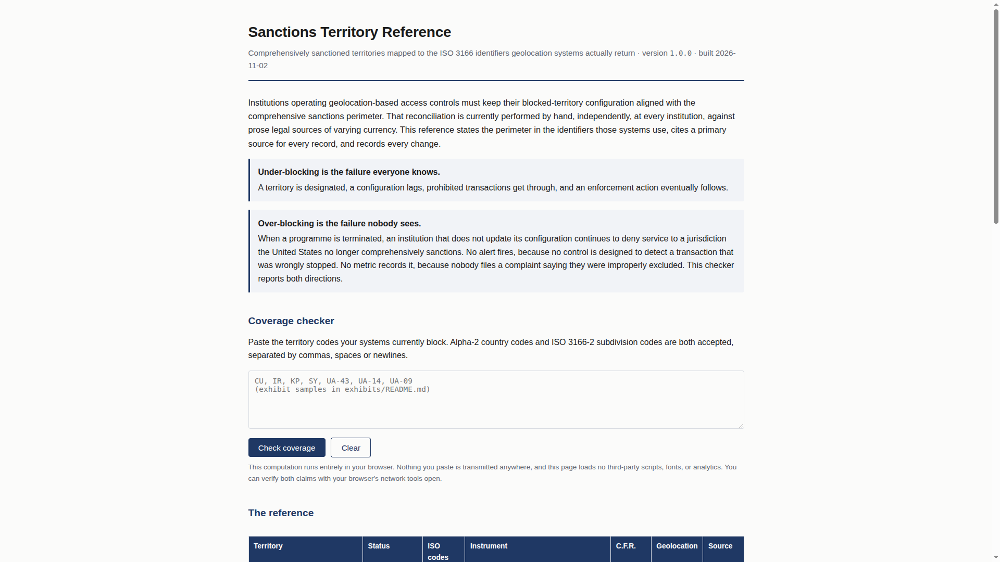
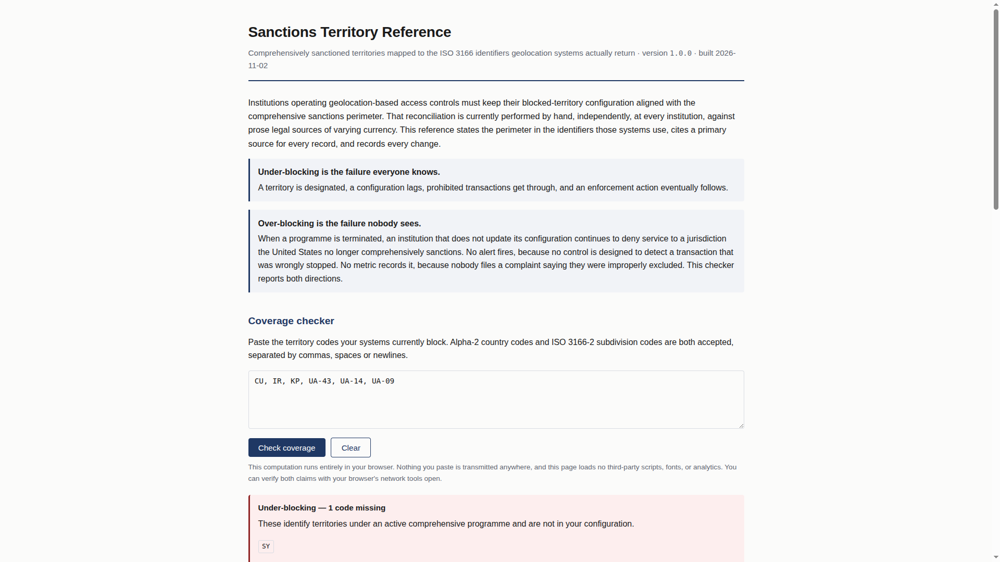
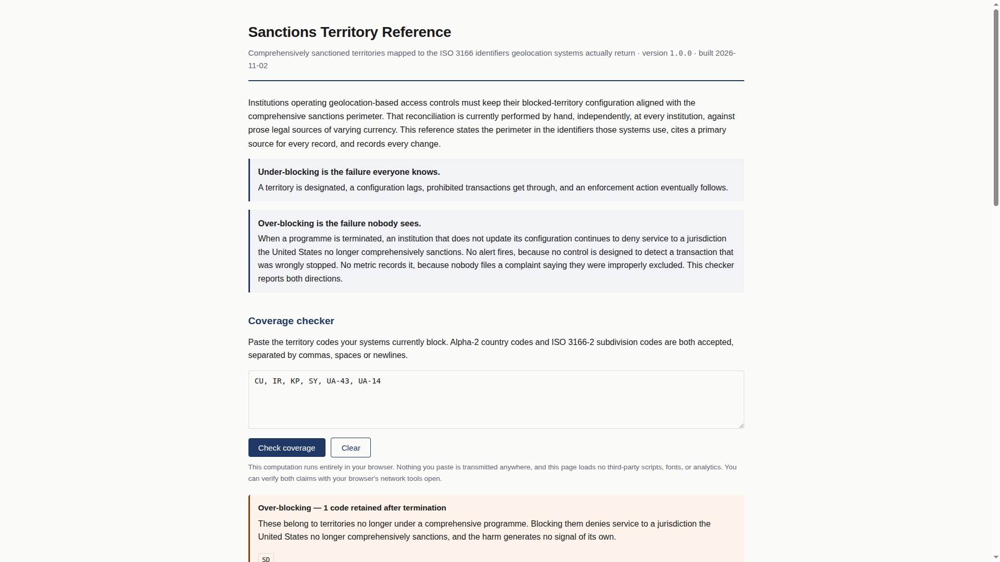
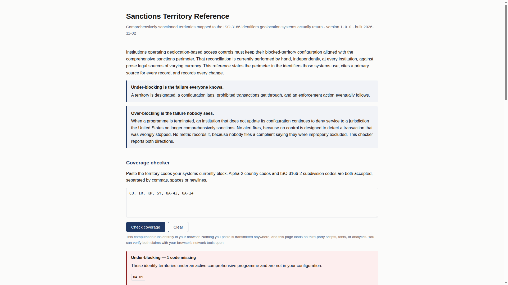

# Exhibit package — G.5, G.6, G.7

**Project:** Sanctions Territory Reference  
**Preparer:** Divine Linus  
**Repository:** https://github.com/Divine16/sanctions-territory-reference  
**Zenodo (dataset v0.1.0):** https://zenodo.org/records/23677148 · DOI [10.5281/zenodo.23677148](https://doi.org/10.5281/zenodo.23677148)  
**Prepared:** 2026-11-02 (UTC)  
**Artifact folder:** `exhibits/artifacts/` (regenerate with `python3 scripts/generate_exhibit_artifacts.py`)

---

## Master checklist

| ID | Requirement | Status | Location in this package |
|----|-------------|--------|---------------------------|
| G.5.1 | Landing page PDF with **live URL and date** | **Pending** | § G.5.1 — print from Pages once live; interim screenshot `artifacts/G5-01-landing.png` |
| G.5.2 | Screenshot — under-blocking | **Done** | § G.5.2 · `artifacts/G5-02-under-blocking.png` |
| G.5.3 | Screenshot — over-blocking | **Done** | § G.5.3 · `artifacts/G5-03-over-blocking.png` |
| G.5.4 | Screenshot — partial coverage (multi-code territory) | **Done** | § G.5.4 · `artifacts/G5-04-partial-coverage.png` |
| G.5.5 | Network tab — zero requests (privacy) | **Pending** | § G.5.5 — you capture in browser (DevTools) |
| G.6.1 | Data file — every record with citation | **Done** | § G.6.1 · `artifacts/G6-records-with-citations.md` + `data/territories.json` |
| G.6.2 | CHANGELOG.md | **Done** | § G.6.2 |
| G.6.3 | Staleness workflow YAML + run record | **Partial** | § G.6.3 · YAML included; **run record** from GitHub Actions |
| G.6.4 | `validate.py` — two enforced rules | **Done** | § G.6.4 |
| G.6.5 | CI failing on deliberately broken record | **Pending** | § G.6.5 · `exhibits/G.6-ci-failure-demo.md` |
| G.7.1 | Feed URL | **Done** | § G.7.1 |
| G.7.2 | Retrieved JSON + retrieval timestamp | **Partial** | § G.7.2 · local build copy until Pages returns 200 |
| G.7.3 | Build script — feed from single data file | **Done** | § G.7.3 |
| G.7.4 | Wayback capture | **Pending** | § G.7.4 — after feed URL is live |

---

# G.5 — Territory site and coverage checker

**Intended live site:** https://divine16.github.io/sanctions-territory-reference/  
*(Enable GitHub Pages: branch `main`, folder `/docs`. As of package preparation the feed URL returned 404 until Pages is enabled.)*

## G.5.1 Landing page (PDF + URL + date)

**Action:** Open the live site → **Print → Save as PDF** with browser headers/footers enabled so the PDF shows URL and date.

**Interim evidence (local preview, 2026-11-02 build):**



## G.5.2 Under-blocking

Input pasted (missing active code **SY**):

```text
CU, IR, KP, UA-43, UA-14, UA-09
```



## G.5.3 Over-blocking

Input pasted (terminated **SD** still blocked):

```text
CU, IR, KP, SY, UA-43, UA-14, UA-09, SD
```



## G.5.4 Partial coverage

Input pasted (territory with **UA-14** and **UA-09** — only one present):

```text
CU, IR, KP, SY, UA-43, UA-14
```



## G.5.5 Privacy — network tab (zero requests)

**Action (required for final submission):**

1. Open the **live** site (not required to be online for checker logic; must be live URL for exhibit narrative).
2. Open DevTools → **Network**.
3. Enable **Preserve log**; optional: filter **Fetch/XHR**.
4. Reload the page.
5. Paste any checker sample and click **Check coverage**.
6. Screenshot the Network panel showing **no** outbound API/analytics requests (only the initial `index.html` document load).

**Claim on page:** *“This computation runs entirely in your browser… this page loads no third-party scripts…”* — the network screenshot is the demonstration.

**Attach:** `artifacts/G5-05-network-zero-requests.png` *(add after capture)*

---

# G.6 — Methodology, citations, change log

## G.6.1 Data file — records and primary-source citations

Source of truth: `data/territories.json`. Summary table (generated):

<!-- Include generated table -->
See file: [`artifacts/G6-records-with-citations.md`](artifacts/G6-records-with-citations.md)

| ID | Official name | Status | ISO codes | Primary source | last_verified | verified_by |
|----|---------------|--------|-----------|----------------|---------------|-------------|
| cuba-comprehensive | Cuba | active | CU | https://www.ecfr.gov/current/title-31/subtitle-B/chapter-V/part-515 | 2026-10-26 | Divine Linus |
| iran-comprehensive | Iran | active | IR | https://www.ecfr.gov/current/title-31/subtitle-B/chapter-V/part-560 | 2026-10-26 | Divine Linus |
| north-korea-comprehensive | North Korea | active | KP | https://www.ecfr.gov/current/title-31/subtitle-B/chapter-V/part-510 | 2026-10-26 | Divine Linus |
| syria-comprehensive | Syria | active | SY | https://www.ecfr.gov/current/title-31/subtitle-B/chapter-V/part-542 | 2026-10-26 | Divine Linus |
| ukraine-crimea-region | Crimea region of Ukraine | active | UA-43 | https://www.federalregister.gov/documents/2014/12/24/2014-30194/ukraine-related-sanctions-regulations | 2026-10-26 | Divine Linus |
| ukraine-donetsk-luhansk-regions | Donetsk/Luhansk regions | active | UA-14, UA-09 | https://www.federalregister.gov/documents/2022/02/28/2022-04254/ukraine-related-sanctions-regulations | 2026-10-26 | Divine Linus |
| sudan-comprehensive-terminated | Sudan | terminated | SD | https://www.federalregister.gov/documents/2020/10/16/2020-22935/sudanese-sanctions-regulations | 2026-10-26 | Divine Linus |

## G.6.2 CHANGELOG.md

```markdown
# Change log

Append-only. Every modification to `data/territories.json` is recorded here with
the instrument that caused it. Entries are never edited or removed — a correction
is a new entry stating what was wrong and what it now says.

Format: `YYYY-MM-DD — territory — change — causing instrument — who`

---

## 2026-10-26

- 2026-10-26 — Cuba — initial active comprehensive record — Cuban Assets Control Regulations (31 C.F.R. Part 515) — Divine Linus
- 2026-10-26 — Iran — initial active comprehensive record — Iranian Transactions and Sanctions Regulations (31 C.F.R. Part 560) — Divine Linus
- 2026-10-26 — North Korea — initial active comprehensive record — North Korea Sanctions Regulations (31 C.F.R. Part 510) — Divine Linus
- 2026-10-26 — Syria — initial active comprehensive record — Syrian Sanctions Regulations (31 C.F.R. Part 542) — Divine Linus
- 2026-10-26 — Crimea region of Ukraine — initial active regional record — Executive Order 13685 (2014) — Divine Linus
- 2026-10-26 — Donetsk/Luhansk regions of Ukraine — initial active regional record with scope/ISO mismatch note — Executive Order 14065 (2022) — Divine Linus
- 2026-10-26 — Sudan — initial terminated comprehensive record (programme lifted) — Executive Order 13942 (2020); 31 C.F.R. Part 538 wind-down — Divine Linus
```

*(Canonical copy: `CHANGELOG.md` / `artifacts/G6-CHANGELOG.md`.)*

## G.6.3 Staleness workflow + run record

**Workflow file:** `.github/workflows/staleness.yml`

```yaml
name: Verification staleness

on:
  schedule:
    - cron: "0 14 * * 1"
  workflow_dispatch:

permissions:
  contents: read
  issues: write

jobs:
  check:
    runs-on: ubuntu-latest
    steps:
      - uses: actions/checkout@v4

      - name: Report records older than 90 days
        id: stale
        run: |
          set +e
          python3 scripts/validate.py --staleness 90 2>&1 | tee staleness.log
          code=$?
          echo "exit_code=$code" >> "$GITHUB_OUTPUT"
          exit 0

      - name: Open issue when stale
        if: steps.stale.outputs.exit_code != '0'
        uses: actions/github-script@v7
        with:
          script: |
            # … opens GitHub issue with staleness.log when threshold exceeded
```

**Run record (attach):**

1. GitHub → **Actions** → **Verification staleness** → **Run workflow** → Run.
2. Screenshot or download log showing `All records verified within 90 days.` (success) or issue body (failure path).
3. Save as `artifacts/G6-staleness-run-screenshot.png` or export log to `artifacts/G6-staleness-run.log`.

## G.6.4 Two enforced rules (`validate.py`)

No record ships without a citation; no record ships unverified.

```python
        # ---- the integrity rules that matter
        src = r.get("primary_source")
        if not isinstance(src, str) or not src.strip():
            p.add(where, "primary_source is required — no record ships without a citation")
        elif PLACEHOLDER.search(src):
            p.add(where, "primary_source is still a placeholder")

        if r.get("verified") is not True:
            p.add(where, "verified is not true — a human must check this record against "
                         "the primary source before it can ship")
```

Full excerpt: `artifacts/G6-validate-enforced-rules.py.txt` · source: `scripts/validate.py`.

**CI on every push:** `.github/workflows/ci.yml` runs `make validate`, `make build`, and fails if `docs/` drift.

## G.6.5 CI failure on deliberately broken record

Follow [`G.6-ci-failure-demo.md`](G.6-ci-failure-demo.md): branch with `"verified": false` → failed **CI** job **Validate data** → screenshot.

**Attach:** `artifacts/G6-ci-failure-screenshot.png`

---

# G.7 — Machine-readable feed

## G.7.1 Feed URL

```text
https://divine16.github.io/sanctions-territory-reference/feed.json
```

Stable path in repository after build: `docs/feed.json`.

## G.7.2 Retrieved JSON + timestamp

**Metadata** (`artifacts/G7-feed-retrieval-metadata.json`):

```json
{
  "retrieved_at_utc": "2026-11-02T19:29:55.444942+00:00",
  "feed_url": "https://divine16.github.io/sanctions-territory-reference/feed.json",
  "retrieval_method": "local_build_copy",
  "note": "Replace with live curl capture once GitHub Pages returns 200.",
  "live_url_error": "HTTP Error 404: Not Found",
  "source_path": "docs/feed.json"
}
```

**Payload:** `artifacts/G7-feed-retrieved-2026-11-02T192955Z.json`

**After Pages is live, refresh:**

```sh
python3 scripts/generate_exhibit_artifacts.py
curl -sS -D exhibits/artifacts/G7-feed-http-headers.txt \
  -o exhibits/artifacts/G7-feed-retrieved-live.json \
  'https://divine16.github.io/sanctions-territory-reference/feed.json'
date -u +'%Y-%m-%dT%H:%M:%SZ' > exhibits/artifacts/G7-feed-retrieved-live.timestamp.txt
```

## G.7.3 Build script — single source file

From `scripts/build.py` (only `data/territories.json` is read for feed records):

```python
    # ---- the feed: the same records, nothing added, nothing hidden
    feed = {
        "name": "Sanctions Territory Reference",
        "version": version,
        "generated": built,
        "source_file": "data/territories.json",
        "record_count": len(territories),
        "active_count": sum(1 for t in territories if t["status"] == "active"),
        "notice": ("Comprehensive territorial sanctions programmes only. ..."),
        "territories": territories,
    }

    OUT.mkdir(parents=True, exist_ok=True)
    (OUT / "feed.json").write_text(
        json.dumps(feed, indent=2, ensure_ascii=False) + "\n", encoding="utf-8")
```

Full excerpt: `artifacts/G7-build-feed-generation.py.txt`.

## G.7.4 Wayback capture

**After** the feed URL returns **200**:

1. Open https://web.archive.org/save  
2. Save: `https://divine16.github.io/sanctions-territory-reference/feed.json`  
3. Screenshot confirmation and archived page.  
4. Attach: `artifacts/G7-wayback-feed-screenshot.png` and note the `web.archive.org` URL here:

```text
Wayback URL: _______________________________________________
Captured on: ______________________________________________
```

---

## Exporting this package as one PDF

From repo root (no pandoc required):

```sh
pip install markdown    # once
make exhibit-pdf        # runs make exhibits, then writes PDF via Chrome headless
```

Output: `exhibits/EXHIBIT-PACKAGE-G5-G7.pdf` (and `EXHIBIT-PACKAGE-G5-G7.html`).

**Alternative:** open `exhibits/EXHIBIT-PACKAGE-G5-G7.html` in Chrome → **Print → Save as PDF** (enable background graphics).

Optional: `sudo apt install pandoc` then `pandoc exhibits/EXHIBIT-PACKAGE-G5-G7.md -o exhibits/EXHIBIT-PACKAGE-G5-G7.pdf --resource-path=exhibits`

**Final bundle to submit:** this PDF + `artifacts/` folder (or zip `exhibits/`).
